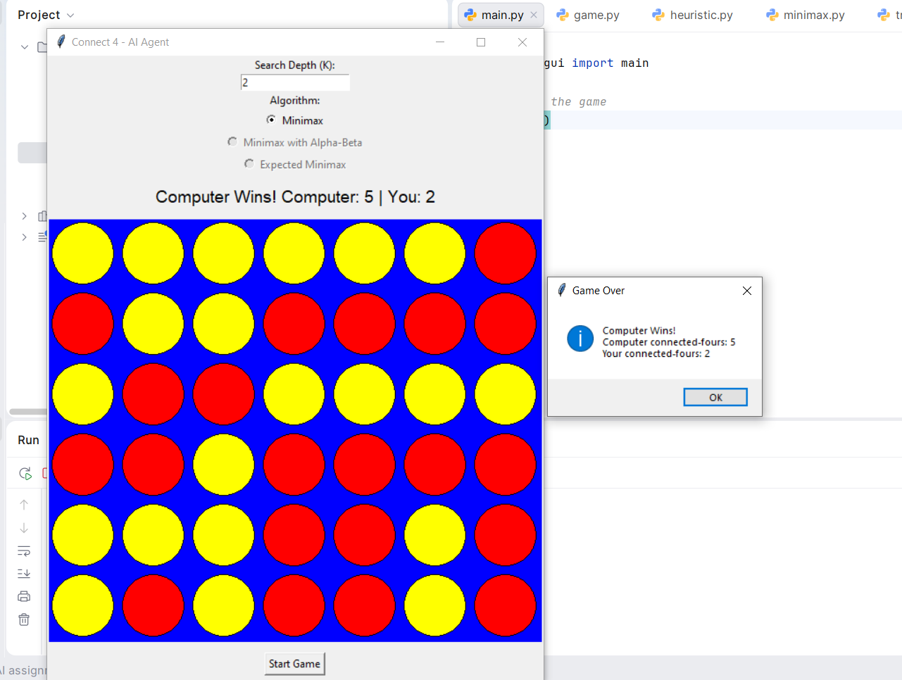

# Assignment 2 – Connect 4 AI Agent
## Part 1: Minimax without Alpha-Beta Pruning 

---

## 1. Data Structures

- **Board:** a 2D list (6 rows × 7 columns).
  - `0` = empty, `1` = human, `2` = computer.
  - Row 0 is the top of the board and row 5 is the bottom.
- **Copying the board:** for every move tried in the tree, a new copy of the board is made
  (`[row[:] for row in board]`), so the original board is never changed during the search.
- **Valid moves:** a list of column numbers whose top cell is still empty.
- **Window:** a list of 4 cells (horizontal, vertical or diagonal) used by the heuristic.
- **Recursion:** the Minimax tree is not stored in memory. It is explored using recursive
  calls, and every node is printed as soon as it is visited.

---

## 2. Game Rules (as implemented)

- Board size is **7 columns × 6 rows** (width ≥ 7 and length ≥ 6 as required).
- A disc falls to the lowest empty cell of the chosen column.
- The game does **not** stop when someone connects four. It continues until the board is full.
- At the end, the player with more **connected-fours** wins.

---

## 3. Minimax Algorithm

The computer is the **MAX** player and the human is the **MIN** player.

```
minimax(board, depth, K, maximizing):
    if board is full:
        return (computer_fours - human_fours) * 100000
    if depth == K:
        return heuristic(board)

    if maximizing:
        best = -infinity
        for each valid column:
            copy board, drop computer disc
            score = minimax(new_board, depth + 1, K, False)
            best = max(best, score)
    else:
        best = +infinity
        for each valid column:
            copy board, drop human disc
            score = minimax(new_board, depth + 1, K, True)
            best = min(best, score)
    return best
```

- `find_best_move(board, K)` calls Minimax from the root and returns the column chosen by MAX.
- **Full board:** when the board is full the result is known exactly, so the score is the
  difference in connected-fours multiplied by 100000. This makes it larger than any
  heuristic value.
- **Ties:** if two columns have the same score, the column on the left is chosen
  (because we only replace the best move when the score is strictly better).
- **Nodes expanded:** a node is counted as expanded when its children are generated,
  so leaf nodes (depth K) are **not** counted.
- **Time:** measured using `time.perf_counter()` around the whole search.

---

## 4. Heuristic Function

The heuristic looks at **every window of 4 cells** on the board (horizontal, vertical and both
diagonals) and adds up a score for each window. A positive score is good for the computer and a
negative score is good for the human.

| Window contents | Score |
|-----------------|-------|
| 4 computer discs (completed four) | +100 |
| 3 computer discs + 1 empty | +10 |
| 2 computer discs + 2 empty | +5 |
| 4 human discs (completed four) | −100 |
| 3 human discs + 1 empty | −10 |
| 2 human discs + 2 empty | −5 |
| Window with both colours | 0 (nobody can complete it) |

**Center column:** each computer disc in the middle column adds **+3** and each human disc
there adds **−3**, because the center column is part of the largest number of possible fours.

**Why these factors:**
- **Completed fours** are the actual score of the game, so they get the largest weight.
- **3-in-a-window and 2-in-a-window** count the candidate points each player has, meaning
  places where a new four can still be made.
- A window that contains both colours can never become a four, so it scores nothing.
- The heuristic is **symmetric**: it gives a bigger number when the computer is closer to
  winning and a smaller number when the human is closer to winning.

---

## 5. Tree Printing

Every turn, the full Minimax tree is printed to the console in a readable form:

- The **current board** is printed at the top.
- Each level is **indented** by 4 spaces.
- `MAX Node` / `MIN Node` shows whose turn it is at that node.
- `Computer plays column X` / `Human plays column X` shows the move on each branch.
- At depth K, each **leaf board is printed** (`C` = computer, `H` = human, `.` = empty),
  together with its **Heuristic Value**.
- After each branch, `Column X -> value Y` shows the value that branch returned.
- `MAX chooses` / `MIN chooses` shows the selected column and its score.
- At the end it prints the best move, nodes expanded and time taken.

---

## 6. Sample Runs

### Sample Run 1 – K = 1 (human played column 3)

The computer looks one move ahead and evaluates 7 boards.

```
========== MINIMAX TREE (K = 1 ) ==========
Current Board:
. . . . . . .
. . . . . . .
. . . . . . .
. . . . . . .
. . . . . . .
. . . H . . .
0 1 2 3 4 5 6

MAX Node
  Computer plays column 0
    Leaf Node
      . . . . . . .
      . . . . . . .
      . . . . . . .
      . . . . . . .
      . . . . . . .
      C . . H . . .
      0 1 2 3 4 5 6
    Heuristic Value: -3
  Column 0 -> value -3
  Computer plays column 1
    ...
  Computer plays column 6
    Leaf Node
      . . . . . . .
      . . . . . . .
      . . . . . . .
      . . . . . . .
      . . . . . . .
      . . . H . . C
      0 1 2 3 4 5 6
    Heuristic Value: -3
  Column 6 -> value -3
MAX chooses: 3 Score: 0

Best move: 3
Best score: 0
Nodes expanded: 1
Time taken: 0.0003 seconds
```

Playing column 3 (on top of the human disc) gives 0. It cancels the human's center bonus,
so the computer chooses it.

### Sample Run 2 – K = 2 (human has three in a row)

The human has discs in columns 1, 2 and 3 of the bottom row. **Both** column 0 and column 4
would complete a four for the human.

```
========== MINIMAX TREE (K = 2 ) ==========
Current Board:
. . . . . . .
. . . . . . .
. . . . . . .
. . . . . . .
. . . . . . C
. H H H . . C
0 1 2 3 4 5 6

MAX Node
  ...
  Column 3 -> value -110
  Computer plays column 4
    MIN Node
      Human plays column 0
        Leaf Node
          . . . . . . .
          . . . . . . .
          . . . . . . .
          . . . . . . .
          . . . . . . C
          H H H H C . C
          0 1 2 3 4 5 6
        Heuristic Value: -98
      Column 0 -> value -98
      Human plays column 1
        Leaf Node
          . . . . . . .
          . . . . . . .
          . . . . . . .
          . . . . . . .
          . H . . . . C
          . H H H C . C
          0 1 2 3 4 5 6
        Heuristic Value: -13
      Column 1 -> value -13
      ...
      Human plays column 6
        Leaf Node
          . . . . . . .
          . . . . . . .
          . . . . . . .
          . . . . . . H
          . . . . . . C
          . H H H C . C
          0 1 2 3 4 5 6
        Heuristic Value: -13
      Column 6 -> value -13
    MIN chooses: 0 Score: -98
  Column 4 -> value -98
  ...
    MIN chooses: 4 Score: -108
  Column 6 -> value -108
MAX chooses: 4 Score: -98

Best move: 4
Best score: -98
Nodes expanded: 8
Time taken: 0.0019 seconds
```

Summary of the root's children:

| Computer column | Value (after MIN's best reply) |
|---|---|
| 0 | −108 |
| 1 | −118 |
| 2 | −118 |
| 3 | −110 |
| **4** | **−98** |
| 5 | −108 |
| 6 | −108 |

The computer **blocks column 4**. The human can still complete a four in column 0
(MIN chooses 0), but blocking one side is the best the computer can do, because the human's
three is open on both sides. The search sees this, so every branch has a negative value.

### Sample Run 3 – Full game in the GUI (K = 2)

The game was played until the board was full.



Final result: **Computer 5 connected-fours, Human 2 → Computer Wins.**

Checking the count by hand:
- Computer: 3 overlapping fours in the top row (columns 0–3, 1–4, 2–5), 1 four in the
  third row (columns 3–6), and 1 diagonal = **5**.
- Human: row 2 columns 3–6 and row 4 columns 3–6 = **2**.

---

## 7. Performance (Nodes Expanded and Time)

The table below comes from `benchmark.py`. Tree printing is hidden while timing, so the time
measures the search only.

### Empty board

| K | Nodes Expanded | Time (s) |
|---|---|---|
| 1 | 1 | 0.0008 |
| 2 | 8 | 0.0046 |
| 3 | 57 | 0.0232 |
| 4 | 400 | 0.1608 |
| 5 | 2801 | 1.1050 |

### Middle-game board (8 discs played)

| K | Nodes Expanded | Time (s) |
|---|---|---|
| 1 | 1 | 0.0005 |
| 2 | 8 | 0.0051 |
| 3 | 57 | 0.0343 |
| 4 | 400 | 0.1968 |
| 5 | 2801 | 1.2770 |

### Analysis

- Minimax without pruning visits **every** node up to depth K. With 7 possible moves,
  the number of expanded nodes is

  1 + 7 + 7² + … + 7^(K−1) = (7^K − 1) / 6

  which gives exactly 1, 8, 57, 400, 2801.
- Each extra level multiplies the nodes and the time by about **7**, so the growth is
  exponential, O(7^K).
- The node count is the **same for both boards**. Plain Minimax does not depend on how good
  the moves are, only on how many moves are available. The count only becomes smaller
  near the end of the game, when some columns are full.
- When the tree is printed to the console, a turn takes much longer than the times above.
  At K = 5 the tree is about 176,000 lines.
- These numbers are the baseline for the comparison with Alpha-Beta pruning, which should
  expand fewer nodes for the same K and give the same move.

---

## 8. Assumptions

- The human always plays first (Red). The computer is Yellow.
- The game ends only when the board is full, not at the first connect-four.
- **Overlapping fours are counted separately.** For example, 5 discs in a row count as
  2 connected-fours. The same rule is used in the final score and in the heuristic.
- A node is counted as **expanded** when its children are generated (leaves are not counted).
- The search depth K is read when **Start Game** is pressed and stays the same for the whole game.
- If two moves have the same value, the leftmost column is chosen.

---

