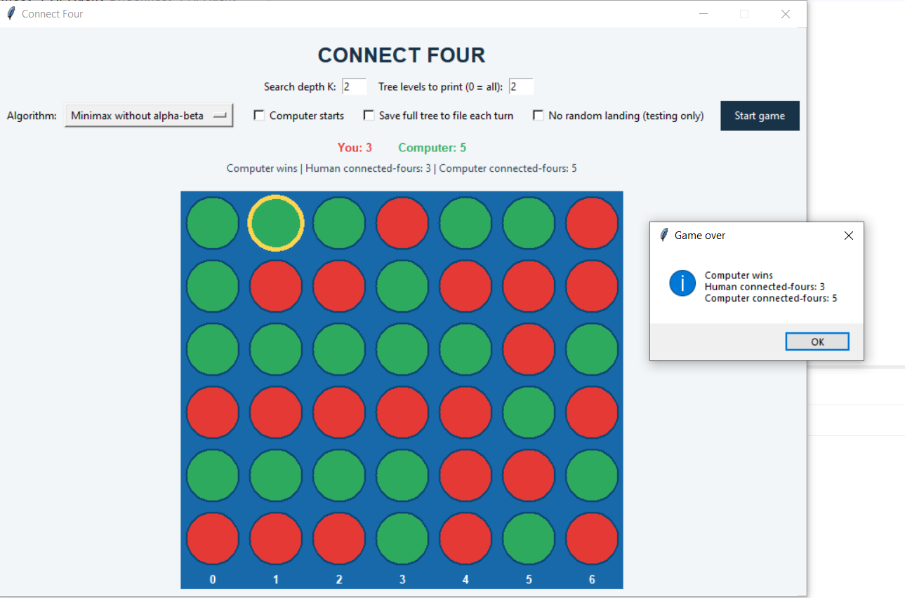

# Assignment 2 – Connect 4 AI Agent
## Part 1: Minimax without Alpha-Beta Pruning (Student 1)

---

## 1. Overview

In this part I implemented the **Minimax algorithm without alpha-beta pruning**. The algorithm:

- Searches the game tree up to depth **K**.
- Evaluates the boards at depth K using the shared **heuristic function**.
- Prints the **Minimax tree** to the console every turn, including the heuristic value of each
  evaluated board.
- Records the **number of nodes expanded** and the **time taken** for each move.

---

## 2. Data Structures

- **Board:** a 2D list (6 rows × 7 columns).
  - `0` = empty, `1` = human, `2` = computer.
  - Row 0 is the top of the board and row 5 is the bottom.
- **New board per move:** `drop_disc` returns a **new copy** of the board with the disc added,
  so the board being searched is never changed.
- **Valid moves:** a list of columns whose top cell is still empty.
- **Windows:** a list of all groups of 4 cells in a line (horizontal, vertical and both
  diagonals). It is built once in `board.py` and used by the heuristic and by the
  connected-fours count.
- **Tree lines:** a list of `(level, text)` pairs filled during the search. It is used to print
  the tree with indentation, or to save it to a file. A line for a move is reserved before the
  recursive call and filled after the child returns its value.
- **Result object (`MinimaxResult`):** holds the chosen column, its value, the number of nodes
  expanded, the tree lines and the time taken.

---

## 3. Game Rules (as implemented)

- Board size is **7 columns × 6 rows** (width ≥ 7 and length ≥ 6 as required).
- A disc falls to the lowest empty cell of the chosen column. With Minimax there is no
  random slipping; that only applies to Expected Minimax.
- The game does **not** stop when someone connects four. It continues until the board is full.
- At the end, the player with more **connected-fours** wins.

---

## 4. Minimax Algorithm

The computer is the **MAX** player and the human is the **MIN** player.

```
minimax(board, depth_left, maximizing):
    if board is full:
        return (computer_fours - human_fours) * 100000
    if depth_left == 0:
        return heuristic(board)

    nodes_expanded += 1
    if maximizing:
        best = -infinity
        for each valid column:
            child = board with a computer disc in that column
            best = max(best, minimax(child, depth_left - 1, False))
    else:
        best = +infinity
        for each valid column:
            child = board with a human disc in that column
            best = min(best, minimax(child, depth_left - 1, True))
    return best
```

- `find_best_move(board, K)` tries every column at the root and returns the column with the
  highest value.
- **Full board:** the result is known exactly, so the score is the difference in
  connected-fours multiplied by 100000. This makes it larger than any heuristic value.
- **Ties:** if two columns have the same value, the column closer to the **centre** is chosen
  (the same rule as the other two algorithms).
- **Nodes expanded:** a node is counted as expanded when its children are generated. The root
  is counted and the leaves are not. All three algorithms use this same definition.
- **Time:** measured with `time.perf_counter()` around the whole search.
- **Building the tree:** `build_tree=False` skips building the printed tree. The benchmark
  uses it so that only the search itself is timed.

---

## 5. Heuristic Function (shared)

All three algorithms use the same heuristic (`heuristic.py`), so they can be compared fairly.
The score is from the **computer's point of view**: a bigger number means the computer is closer
to winning, and a smaller number means the human is closer to winning.

The heuristic checks **every window of 4 cells** and adds the following:

| Factor | Computer | Human |
|--------|----------|-------|
| Completed connected-four | +100 | −100 |
| 3 discs + 1 empty cell that can be **played now** (immediate threat) | +16 | −16 |
| 3 discs + 1 empty cell that is **not playable yet** (future threat) | +10 | −10 |
| 2 discs + 2 empty cells (potential) | +4 | −4 |
| Window containing both colours | 0 | 0 |

An empty cell can be played now if it is on the bottom row or the cell below it is filled.

**Position:** every disc gets a column weight that grows towards the centre:

| Column | 0 | 1 | 2 | 3 | 4 | 5 | 6 |
|--------|---|---|---|---|---|---|---|
| Weight | 1 | 2 | 3 | 4 | 3 | 2 | 1 |

Computer discs add their column weight and human discs subtract it.

**Why these factors:**
- **Completed fours** decide the winner, so they have the largest weight.
- **Threes and twos** count the candidate points each player has, meaning places where a new
  four can still be made.
- A three whose empty cell can be **played right now** is more dangerous than one that needs
  other discs first, so it gets a higher weight.
- **Central columns** are part of more possible fours.
- A window with both colours can never become a four, so it scores nothing.

---

## 6. Tree Printing

Every turn, the Minimax tree is printed to the console:

- The header shows K, the root value and the chosen column.
- Each level is **indented** by 4 spaces.
- `MIN node (C played col X) value=V` means the computer played column X; the human moves
  next at that node, and V is the value returned.
- `MAX node (H played col X) value=V` means the human played column X.
- At depth K, each leaf shows `Leaf heuristic value = V` followed by the **board**
  (`C` = computer, `H` = human, `.` = empty).
- A full board shows `Leaf (full board) final score = V`.
- The last line shows the nodes expanded and the time taken.

The GUI has a **"Tree levels to print"** field to print only the first levels for large K
(0 prints the whole tree). The **"Save full tree to file each turn"** option writes the complete
tree to `tree_turn_N.txt`.

---

## 7. Sample Runs

### Sample Run 1 – K = 1 (human played column 3)

```
---- Minimax tree (K=1) ----
MAX root (computer to move) -> best value=0, chosen col=3
    MIN node (C played col 0) value=-3
        Leaf heuristic value = -3
            . . . . . . .
            . . . . . . .
            . . . . . . .
            . . . . . . .
            . . . . . . .
            C . . H . . .
            0 1 2 3 4 5 6
    MIN node (C played col 1) value=-2
        ...
    MIN node (C played col 2) value=-1
        ...
    MIN node (C played col 3) value=0
        Leaf heuristic value = 0
            . . . . . . .
            . . . . . . .
            . . . . . . .
            . . . . . . .
            . . . C . . .
            . . . H . . .
            0 1 2 3 4 5 6
    MIN node (C played col 4) value=-1
        ...
    MIN node (C played col 5) value=-2
        ...
    MIN node (C played col 6) value=-3
        ...
Nodes expanded: 1  |  time: 0.0003 s
```

The values follow the column weights: the human's disc in column 3 gives −4, and the computer's
disc adds its column weight (1, 2, 3, 4, 3, 2, 1). Playing on top in column 3 cancels the
human's centre advantage (value 0), so the computer chooses column 3.

### Sample Run 2 – K = 2 (human has three in a row)

The human has discs in columns 1, 2 and 3 of the bottom row. **Both** column 0 and column 4
would complete a four for the human.

```
---- Minimax tree (K=2) ----
MAX root (computer to move) -> best value=-101, chosen col=4
    MIN node (C played col 0) value=-121
        ...
    MIN node (C played col 3) value=-130
        ...
    MIN node (C played col 4) value=-101
        MAX node (H played col 0) value=-101
            Leaf heuristic value = -101
                . . . . . . .
                . . . . . . .
                . . . . . . .
                . . . . . . .
                . . . . . . C
                H H H H C . C
                0 1 2 3 4 5 6
        MAX node (H played col 1) value=-22
            Leaf heuristic value = -22
                . . . . . . .
                . . . . . . .
                . . . . . . .
                . . . . . . .
                . H . . . . C
                . H H H C . C
                0 1 2 3 4 5 6
        ...
        MAX node (H played col 6) value=-21
            Leaf heuristic value = -21
                . . . . . . .
                . . . . . . .
                . . . . . . .
                . . . . . . H
                . . . . . . C
                . H H H C . C
                0 1 2 3 4 5 6
    MIN node (C played col 5) value=-120
        ...
Nodes expanded: 8  |  time: 0.0027 s
```

Summary of the root's children:

| Computer column | Value (after MIN's best reply) |
|---|---|
| 0 | −121 |
| 1 | −136 |
| 2 | −135 |
| 3 | −130 |
| **4** | **−101** |
| 5 | −120 |
| 6 | −121 |

The computer **blocks column 4**. The human can still complete a four in column 0
(the MIN node chooses −101), but blocking one side is the best the computer can do, because the
human's three is open on both sides. The search sees this, so every branch has a negative value.

### Sample Run 3 – Full game in the GUI (K = 2)

The game was played with **Minimax without alpha-beta** until the board was full.



Final result: **Computer 5 connected-fours, Human 3 → Computer wins.**

Checking the count by hand (rows numbered 0 to 5 from the top):
- Computer (green): two overlapping fours in row 2 (columns 0–3 and 1–4), one four in row 4
  (columns 0–3), and two diagonals going down-right (from row 0 col 2 and from row 1 col 3)
  = **5**.
- Human (red): two overlapping fours in row 3 (columns 0–3 and 1–4) and one diagonal going
  down-right from row 0 col 3 = **3**.

---

## 8. Performance (Nodes Expanded and Time)

These numbers come from `benchmark.py`, which runs every algorithm on the **same three boards**
with the **same K values**. The tree is not built while timing (`build_tree=False`), so the time
measures the search only.

The boards:
- **empty:** an empty board.
- **early:** 6 discs played.
- **middle:** 18 discs played (columns 2, 3 and 4 already have 4 discs each).

### Minimax without alpha-beta

| Board | K | Nodes Expanded | Time (s) | Best column | Value |
|---|---|---|---|---|---|
| empty | 1 | 1 | 0.0005 | 3 | 4 |
| empty | 2 | 8 | 0.0032 | 3 | 0 |
| empty | 3 | 57 | 0.0220 | 3 | 9 |
| empty | 4 | 400 | 0.1838 | 3 | 0 |
| early | 1 | 1 | 0.0004 | 2 | 17 |
| early | 2 | 8 | 0.0027 | 2 | 2 |
| early | 3 | 57 | 0.0197 | 3 | 27 |
| early | 4 | 400 | 0.1371 | 3 | 5 |
| middle | 1 | 1 | 0.0005 | 5 | −88 |
| middle | 2 | 8 | 0.0033 | 3 | −106 |
| middle | 3 | 57 | 0.0282 | 3 | −79 |
| middle | 4 | 397 | 0.1646 | 3 | −98 |

### Analysis

- Minimax without pruning visits **every** node up to depth K. With 7 possible moves the number
  of expanded nodes is

  1 + 7 + 7² + … + 7^(K−1) = (7^K − 1) / 6

  which gives exactly 1, 8, 57 and 400.
- Each extra level multiplies the nodes and the time by about **7**, so the growth is
  exponential, O(7^K).
- The node count depends only on **how many moves are available**, not on which moves are good.
  It is the same for the empty and early boards, and slightly smaller for the middle board
  (397 at K = 4), because there columns 2, 3 and 4 become full inside the search, so some
  branches have fewer moves.
- With the whole tree printed to the console, a turn takes much longer than these times:
  at K = 4 the full tree has 2,401 leaf boards.

### Comparison with Alpha-Beta (same boards)

| Board | K | Minimax nodes | Alpha-Beta nodes | Minimax time (s) | Alpha-Beta time (s) |
|---|---|---|---|---|---|
| empty | 3 | 57 | 43 | 0.0220 | 0.0113 |
| empty | 4 | 400 | 226 | 0.1838 | 0.1049 |
| early | 3 | 57 | 31 | 0.0197 | 0.0078 |
| early | 4 | 400 | 183 | 0.1371 | 0.0367 |
| middle | 3 | 57 | 44 | 0.0282 | 0.0109 |
| middle | 4 | 397 | 226 | 0.1646 | 0.0491 |

Both algorithms return **exactly the same value** on every board and every K. This is expected,
because alpha-beta pruning skips only branches that cannot change the result. Alpha-beta expands
fewer nodes, and the saving grows with K (about 43–54% fewer nodes at K = 4).

---

## 9. Assumptions

- The human plays first by default. The "Computer starts" option lets the computer play first.
- The game ends only when the board is full, not at the first connect-four.
- **Overlapping fours are counted separately.** For example, 5 discs in a row count as
  2 connected-fours. The same rule is used in the final score and in the heuristic.
- A node is counted as **expanded** when its children are generated. The root is counted and
  the leaves are not.
- The search depth K is read when **Start game** is pressed and stays the same for the whole game.
- If two moves have the same value, the column closer to the centre is chosen.
